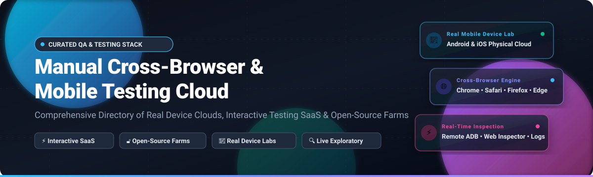

  

# 🧪 Awesome Manual Cross-Browser & Mobile Testing 📱💻

  
  
  
  
  
  

> 🌟 **A curated directory of top Manual Cross-Browser and Mobile Testing platforms** — featuring commercial SaaS real-device clouds, interactive browser emulators, and self-hosted open-source device farms for manual exploratory testing, QA validation, remote debugging, and multi-OS UX verification. 🌟

---

## 🧭 Overview & SEO Highlights

Whether validating responsive web design across Chromium, WebKit (Safari), and Gecko (Firefox), or performing exploratory manual QA on physical Android and iOS mobile devices, choosing the right testing environment is critical. This guide catalogs:
- ☁️ **Commercial Cloud Real Device Labs:** Cloud infrastructure offering zero-latency manual interactive testing, DevTools inspection, and geolocation simulation.
- 🔓 **Self-Hosted Open-Source Device Farms:** Tools for remote debugging, physical USB device sharing, and self-hosted Selenium/Playwright interactive clusters.
- 💵 **Transparent Pricing & Free Tiers:** Exact starter prices, free plans, and trial duration limits compared side-by-side.

---

## 📋 Table of Contents

- [🌐 Sector Overview & Market Dynamics](#-sector-overview--market-dynamics)
- [🟦 SaaS & Hosted Platforms](#-saas--hosted-platforms)
  - [SaaS Platforms Feature & Pricing Matrix](#-saas-platforms-feature--pricing-matrix)
  - [Platform Deep Dives](#-platform-deep-dives)
- [🟩 Open-Source Software](#-open-source-software)
  - [Open-Source Solutions by Community Traction](#-open-source-solutions-by-community-traction)
  - [Open-Source Deep Dives](#-open-source-deep-dives)
- [📊 Comparison at a Glance](#-comparison-at-a-glance)
- [📈 Star History](#-star-history)
- [🤝 Contributing](#-contributing)
- [💖 Support & Sponsorship](#-support--sponsorship)
- [📄 License](#-license)

---

## 🌐 Sector Overview & Market Dynamics

The global cross-browser and mobile device testing market is valued at approximately **$1.7B – $2.8B** and is projected to surpass **$5.5B – $6.2B by 2032**, expanding at a robust **CAGR of ~11%–12%**. 

The sector is **moderately fragmented yet top-heavy**, with dominant market leaders (BrowserStack and Sauce Labs) capturing substantial enterprise market share due to proprietary physical device infrastructure, while emerging players compete intensely around developer UX, AI test assistance, and budget-friendly pricing tiers.

---

## 🟦 SaaS & Hosted Platforms

Commercial, cloud-hosted platforms delivering on-demand access to real browsers, virtual emulators, and physical iOS and Android smartphones without hardware maintenance overhead.

### 📊 SaaS Platforms Feature & Pricing Matrix

Sorted by company scale (valuation / estimated annual revenue) in descending order:

| Platform | Company Size (Valuation / Est. Revenue) | Starting Tier Pricing | Free Tier / Free Trial Limits | Target Use Case & Core Focus |
|:---|:---|:---|:---|:---|
| **[BrowserStack Live](https://www.browserstack.com/live)** | **$4.0B Valuation** (~$230M ARR) | **$29/mo** (billed annually, $39 month-to-month) | **30 minutes total** free trial (instant interactive access across desktop & mobile) | Broadest real device and browser coverage with zero maintenance |
| **[Sauce Labs Live](https://saucelabs.com/products/live-testing)** | **~$613M Valuation** (~$90M Revenue) | **$39/mo** (billed annually, $49 month-to-month) | **28-day free trial** (includes 60 pooled test minutes & 3 parallel VMs) | Manual exploratory & usability testing for cross-browser web apps |
| **[LambdaTest Live](https://www.lambdatest.com/real-time-testing)** | **~$400M Valuation** (~$25M+ ARR) | **$15/mo** (billed annually, $19 month-to-month) | **Free Forever plan**: 2-minute session caps per test, 200+ desktop browsers | High-frequency live web testing with integrated DevTools & bug tracking |
| **[HeadSpin](https://www.headspin.io/)** | **~$28M Valuation** (~$21M Revenue) | **$39/mo** (billed annually, $49 month-to-month for CloudTest Lite) | **Free Trial via Sales Demo** (No public self-serve free plan; 40 hrs/mo on paid Lite) | Long manual testing sessions with full remote ADB shell access |
| **[Kobiton](https://kobiton.com/)** | **$40M+ Funding** (~$27M Est. Revenue) | **$83/mo** (Startup plan billed annually) | **15-day free trial** (includes initial evaluation device credits) | Real mobile device manual testing with step-by-step session evidence |
| **[Appetize.io](https://appetize.io/)** | **~$20M+ Funding** (~$5M–$12M Revenue) | **$59/mo** (Starter plan billed annually) | **Free Forever plan**: 30 total minutes/month, 3-minute max session limit, 2 devices | Browser-streamed interactive iOS & Android app demos and QA |
| **[TestGrid](https://testgrid.io/)** | **Multi-Million Institutional** (Compunnel-backed) | **$199/seat/mo** (CoTester Starter) | **Free Forever tier**: Up to 5 users, 200 device minutes/month limit | AI-assisted debugging, manual testing with real-time CPU/memory vitals |
| **[Browserling](https://www.browserling.com/)** | **Bootstrapped** (~$560K Revenue) | **$19/mo** (Developer tier; Starter from $9/mo) | **Free Forever plan**: 3-minute max session limit, 10 sessions/month | Instant browser testing with full VM reboot, native Safari & OS control |
| **[TestingBot](https://testingbot.com/)** | **Bootstrapped / Lean** (~$200K–$1M Revenue) | **$20/mo** (billed annually, $30 month-to-month) | **14-day free trial** (up to 100 pooled test minutes, 5-min session limit) | Budget-conscious teams wanting access to 6,100+ browsers and devices |
| **[Comparium](https://comparium.app/)** | **Utility Suite** (Electronic Team subsidiary) | **$15/mo** (Basic Plan billed annually) | **Free Forever plan**: Basic single-page compatibility checks & screenshots | Chrome extension-driven instant cross-browser visual comparisons |

---

### 🔍 Platform Deep Dives

#### 🚀 BrowserStack Live & App Live
* **Type:** Real browser and mobile device cloud for interactive manual testing.
* **Key Features:** Cross-browser live inspection, responsive testing, local network testing tunnels, screenshot captures, APK/IPA upload, and native device gesture support.
* **Best For:** Enterprise teams needing comprehensive device/OS coverage without hosting internal hardware.

#### 🧪 Sauce Labs Live Testing
* **Type:** Interactive manual testing on real browsers and cloud devices.
* **Key Features:** Exploratory testing consoles, live browser interaction, session video capture, and seamless integration with existing CI/CD automation pipelines.
* **Best For:** Teams combining manual exploratory testing with continuous automated testing suites.

#### ⚡ LambdaTest Real Time Testing
* **Type:** Real-time cloud interactive testing with built-in debugging tools.
* **Key Features:** Integrated DevTools (Network, Console, Device logs), UI XML Inspector for mobile apps, built-in issue logging (Jira, YouTrack, GitHub), and real-time screen recording.
* **Best For:** Fast-moving QA teams wanting comprehensive live session telemetry and bug reporting.

#### 🔬 Kobiton
* **Type:** Real device manual testing with root-cause analysis.
* **Key Features:** Near-zero latency touch streaming, complex gestures (pinch, zoom, swipe), automated step-by-step video logs, and hardware telemetry (battery, CPU, memory).
* **Best For:** Mobile QA engineers diagnosing complex device-specific gestures and hardware constraints.

#### 🎯 HeadSpin CloudTest Lite
* **Type:** Real-device manual testing platform for emerging teams.
* **Key Features:** Extended session durations (up to 40 hours/month on entry tier), remote ADB shell debugging, support for APK/IPA/OBB, and automatic session device hygiene.
* **Best For:** Individual QA testers requiring uninterrupted, multi-hour mobile debugging sessions.

#### 🌐 TestingBot Live
* **Type:** Budget-friendly manual cross-browser testing platform.
* **Key Features:** Access to 6,100+ browser and OS variations, manual live web testing, native screen recording, and automated screenshot captures.
* **Best For:** Budget-conscious development teams seeking reliable cross-browser validation.

#### 🤖 TestGrid Real Device Cloud
* **Type:** Real device cloud with AI-assisted manual test workflows.
* **Key Features:** CoTester AI assistant, real-time hardware vitals monitoring, Charles Proxy network inspection, and Appium inspector connectivity.
* **Best For:** Teams wanting AI-assisted test step capture alongside deep hardware profiling.

#### 🖥️ Browserling
* **Type:** Interactive browser sandbox with OS-level virtualization.
* **Key Features:** Live Windows, macOS, Android, and Linux environments; native Safari on macOS/iOS; Tor and residential proxy routing; VM reboot controls.
* **Best For:** Developers and security analysts needing low-level OS access and native Safari verification.

#### 📱 Appetize.io
* **Type:** Browser-based client-less mobile simulator & emulator stream.
* **Key Features:** Embeddable web iframes for native iOS & Android apps, URL query parameters for app configuration, instant sharing for product demos.
* **Best For:** Product teams, support desks, and developers wanting instantly shareable mobile previews.

#### 📸 Comparium
* **Type:** Chrome extension and web service for cross-browser visual validation.
* **Key Features:** Multi-browser screenshot captures, automated image comparison modes, and offline mockup comparisons.
* **Best For:** Quick visual design checks across browser layout engines directly from the toolbar.

---

## 🟩 Open-Source Software

Self-hosted, community-driven tools for teams seeking complete data privacy, offline infrastructure, or self-managed device labs.

### 🌟 Open-Source Solutions by Community Traction

Sorted by GitHub star count in descending order:

| Project | GitHub Stars (White Social Badge) | License | Primary Tech Stack | Core Architecture & Capability |
|:---|:---:|:---|:---|:---|
| **[Genymobile/scrcpy](https://github.com/Genymobile/scrcpy)** |  | Apache-2.0 | C / Java / ADB | High-performance, ultra-low latency screen mirroring & physical Android control |
| **[microsoft/playwright](https://github.com/microsoft/playwright)** |  | Apache-2.0 | TypeScript / C++ / Python | Interactive UI Mode, Codegen inspector, and multi-browser execution engine |
| **[SeleniumHQ/selenium](https://github.com/SeleniumHQ/selenium)** |  | Apache-2.0 | Java / Multi-Language | Distributed Selenium Grid 4 with interactive live sessions and VNC inspection |
| **[appium/appium](https://github.com/appium/appium)** |  | Apache-2.0 | Node.js / JavaScript | Cross-platform mobile automation standard supporting interactive device routing |
| **[openstf/stf](https://github.com/openstf/stf)** |  | Apache-2.0 | JavaScript / ADB / RethinkDB | Foundational web-based smartphone test farm for remote Android control |
| **[SeleniumHQ/docker-selenium](https://github.com/SeleniumHQ/docker-selenium)** |  | Apache-2.0 | Shell / Docker | Containerized Chrome/Firefox/Edge nodes with integrated live VNC / noVNC web viewers |
| **[DeviceFarmer/stf](https://github.com/DeviceFarmer/stf)** |  | Apache-2.0 | Node.js / TypeScript / ADB | Actively maintained community fork of STF with modern Android device support |
| **[aerokube/selenoid](https://github.com/aerokube/selenoid)** |  | Apache-2.0 | Go / Docker | Lightweight daemon launching browsers in Docker with live VNC session streaming |
| **[SonicCloudOrg/sonic-server](https://github.com/SonicCloudOrg/sonic-server)** |  | Apache-2.0 | Java / Vue / Spring Boot | Cloud testing platform supporting remote manual control of real Android and iOS devices |
| **[appium/appium-inspector](https://github.com/appium/appium-inspector)** |  | Apache-2.0 | Electron / TypeScript | GUI inspector for exploring mobile application UI hierarchies and live interactions |
| **[shamanec/GADS](https://github.com/shamanec/GADS)** |  | AGPL-3.0 / Proprietary | Go / Appium / WDA | Self-hosted Android & iOS device farm with low-latency WebRTC video streaming |
| **[aerokube/selenoid-ui](https://github.com/aerokube/selenoid-ui)** |  | Apache-2.0 | Go / React | Real-time web dashboard for interactive VNC browser viewing and manual control |

---

### 🔍 Open-Source Deep Dives

#### 📲 [Genymobile/scrcpy](https://github.com/Genymobile/scrcpy)
* **Stack:** C / Java / ADB | **License:** Apache-2.0
* **Overview:** `scrcpy` provides display and control of physical Android devices connected over USB or TCP/IP. It requires no root access and delivers ultra-low latency (35~70ms) with 60fps streaming, clipboard synchronization, physical keyboard/mouse simulation, and seamless file drag-and-drop.
* **Best For:** Developers and QA engineers needing zero-latency manual control over physical Android phones directly on their workstation.

#### 🎭 [microsoft/playwright](https://github.com/microsoft/playwright)
* **Stack:** TypeScript / Node.js / Python / C# | **License:** Apache-2.0
* **Overview:** Playwright offers first-class tooling for interactive web exploration. **Playwright Codegen** allows QA testers to interact with live pages while generating resilient selectors, while **UI Mode** provides a full-featured visual environment with time-travel debugging, network inspection, and DOM snapshot inspection across Chromium, Firefox, and WebKit.
* **Best For:** Modern web QA teams combining manual interactive test discovery with script authoring.

#### 🕸️ [SeleniumHQ/selenium](https://github.com/SeleniumHQ/selenium) & [Docker-Selenium](https://github.com/SeleniumHQ/docker-selenium)
* **Stack:** Java / Docker / Kubernetes | **License:** Apache-2.0
* **Overview:** Selenium Grid 4 provides a distributed execution layer featuring a built-in web console. The bundled `docker-selenium` images provide ready-to-use noVNC endpoints, allowing manual testers to open a browser session inside a container and control it directly through their web browser.
* **Best For:** Organizations seeking a self-hosted, scalable browser grid for both manual and automated regression testing.

#### 📱 [DeviceFarmer/stf](https://github.com/DeviceFarmer/stf)
* **Stack:** Node.js / TypeScript / ADB / RethinkDB | **License:** Apache-2.0
* **Overview:** The primary community-maintained continuation of OpenSTF. DeviceFarmer STF enables teams to control and share physical Android devices via a browser interface. Features include full screen capture, remote tap/swipe gestures, APK drag-and-drop installation, remote ADB shell forwarding, and Chrome DevTools remote inspection.
* **Best For:** Distributed mobile teams needing remote web access to a shared physical bank of Android test hardware.

#### ⚡ [aerokube/selenoid](https://github.com/aerokube/selenoid) & [Selenoid-UI](https://github.com/aerokube/selenoid-ui)
* **Stack:** Go / Docker | **License:** Apache-2.0
* **Overview:** Selenoid is a fast Go-based alternative to Selenium Grid that spins up short-lived Docker containers per browser session. Coupled with Selenoid-UI, users can view active browser sessions via VNC in real time, take manual control, inspect logs, and debug layout discrepancies interactively.
* **Best For:** Lightweight, resource-efficient self-hosted browser testing environments.

#### ☁️ [SonicCloudOrg/sonic-server](https://github.com/SonicCloudOrg/sonic-server)
* **Stack:** Java / Vue / Spring Boot | **License:** Apache-2.0
* **Overview:** Sonic is an open-source, distributed cloud testing platform supporting real Android and iOS devices. It offers remote web-based screen projection, touch gesture control, device vitals monitoring, app management, and multi-device cluster scheduling.
* **Best For:** Engineering teams looking for an all-in-one open-source private device cloud for iOS and Android.

#### 🕹️ [shamanec/GADS](https://github.com/shamanec/GADS)
* **Stack:** Go / Appium / WebDriverAgent | **License:** AGPL-3.0 (core) / Proprietary (hub-ui)
* **Overview:** GADS provides a self-hosted device farm for managing physical Android and iOS devices. Using WebSockets and WebRTC, it streams low-latency device video and handles manual input events (tap, swipe, typing) directly through a web browser.
* **Best For:** Teams wanting self-hosted remote control across both physical Android and iOS phones without external cloud subscriptions.

---

## 📊 Comparison at a Glance

| Tool / Platform | Category | Real Browsers | Real Mobile Devices | Remote ADB / DevTools | Self-Hosted / Privacy | Community Traction |
|:---|:---|:---:|:---:|:---:|:---:|:---|
| **BrowserStack Live** | SaaS Cloud | ✅ | ✅ | ✅ | ❌ | 🏢 Commercial Leader ($4B) |
| **Sauce Labs Live** | SaaS Cloud | ✅ | ✅ | ✅ | ❌ | 🏢 Commercial Enterprise (~$613M) |
| **LambdaTest Live** | SaaS Cloud | ✅ | ✅ | ✅ | ❌ | 🏢 Scaling SaaS (~$400M) |
| **HeadSpin** | SaaS Cloud | ❌ | ✅ | ✅ (Native ADB) | ❌ | 🏢 Enterprise Focus (~$28M) |
| **Kobiton** | SaaS Cloud | ❌ | ✅ | ✅ (Deep Vitals) | ❌ | 🏢 Enterprise Mobile ($40M+ funded) |
| **Appetize.io** | SaaS Cloud | ❌ | 📱 (Emulators) | ❌ | ❌ | 🏢 Web Embedded Demos |
| **Browserling** | SaaS Cloud | ✅ | ✅ (iOS/Android) | ✅ (Full VM) | ❌ | 🏢 Indie Micro-SaaS |
| **TestingBot** | SaaS Cloud | ✅ | ✅ | ✅ | ❌ | 🏢 Budget Cloud Provider |
| **Genymobile/scrcpy** | Open Source | ❌ | ✅ (Android) | ✅ (Direct ADB) | ✅ | ⭐ 154k+ Stars |
| **Playwright UI / Codegen** | Open Source | ✅ | ❌ (Browser Emul.) | ✅ (Built-in) | ✅ | ⭐ 100k+ Stars |
| **Selenium Grid 4** | Open Source | ✅ | ❌ | ✅ (VNC / Debug) | ✅ | ⭐ 34k+ Stars |
| **DeviceFarmer STF** | Open Source | ❌ | ✅ (Android) | ✅ (Remote ADB) | ✅ | ⭐ 4.6k+ Stars |
| **Selenoid + UI** | Open Source | ✅ | ❌ | ✅ (Live VNC) | ✅ | ⭐ 2.9k+ Stars |
| **Sonic Server** | Open Source | ❌ | ✅ (iOS & Android) | ✅ (Cloud Hub) | ✅ | ⭐ 2.2k+ Stars |
| **shamanec/GADS** | Open Source | ❌ | ✅ (iOS & Android) | ✅ (WebRTC) | ✅ | ⭐ 400+ Stars |

---

## 📈 Star History

---

## 🤝 Contributing

Contributions are welcome and greatly appreciated! 💡

If you know of an outstanding manual cross-browser testing platform, self-hosted device farm, or open-source testing utility:
1. Fork this repository.
2. Add your suggested entry to the appropriate section in alphabetical or sorted order.
3. Ensure open-source entries include valid GitHub star badges linking directly to stargazers.
4. Submit a descriptive Pull Request.

Please check out our list of other awesome collections at [Awesome-Awesome-Awesome](https://github.com/ishandutta2007/Awesome-Awesome-Awesome).

---

## 💖 Support & Sponsorship

If this curated guide helped you optimize your QA workflow, discover an open-source tool, or find the right cloud testing provider, please consider supporting the project:

- 🌟 **Star the repository** to boost visibility and help fellow developers find it!
- 🍴 **Fork the repo** to keep a personal copy and contribute improvements.
- 📢 **Share with your network** on LinkedIn, X/Twitter, or your team's QA Slack channels.
- ☕ **Buy me a coffee & become a sponsor:** Support continued open-source development directly via the [GitHub Sponsors Dashboard](https://github.com/sponsors/ishandutta2007).

---

## 📄 License

To the extent possible under law, [Ishan Dutta](https://github.com/ishandutta2007) and contributors have waived all copyright and related or neighboring rights to this work under the **CC0 1.0 Universal Public Domain Dedication**.
